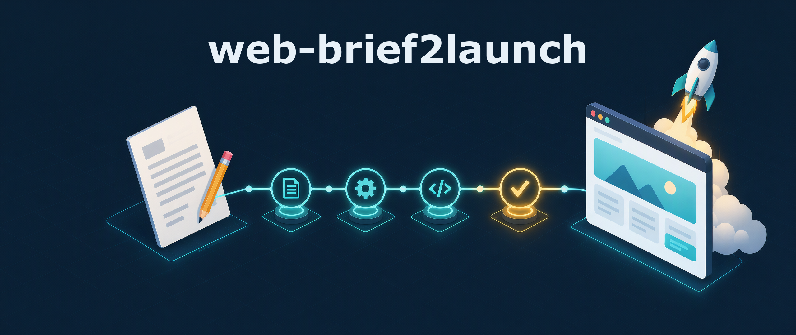
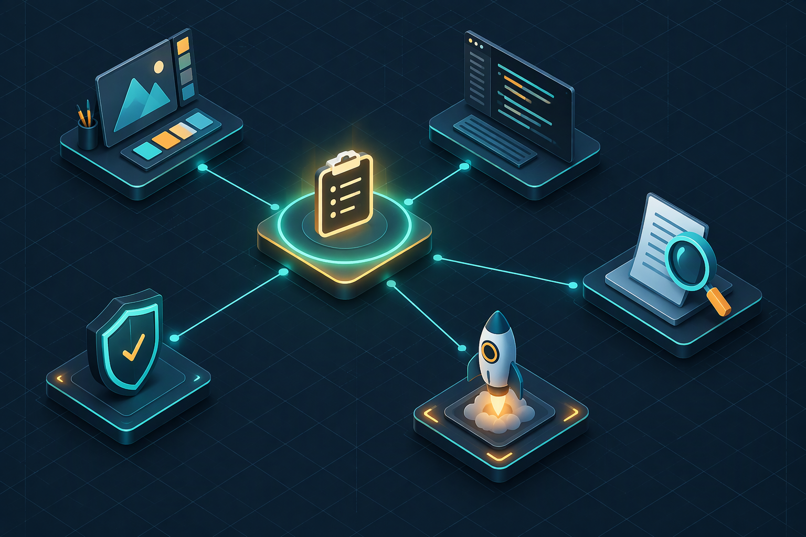

# web-brief2launch



A portable, harness-independent skill set that takes a website from idea to
launch and ongoing maintenance. It is Markdown skills plus optional Node.js
(>= 18) helper scripts, with no product-specific tools, commands, or
integrations. It works in any agent that reads `SKILL.md` files, and in agents
that do not, through `AGENTS.md`.

Version 0.1.0.

## Quick start

One command installs this skill set. The dependency packs install on first use,
from the fixed list in `skills/website-master/scripts/bootstrap.mjs`, after you
approve them.

```bash
npx skills add Kcguner/web-brief2launch --skill '*'
```

`--skill '*'` installs all seven skills; without it the CLI can prompt per skill
and leave a partial install. The CLI asks which agent to target; add
`-a <agent>` to skip that prompt (ids are in the compatibility table).

Cloning is the only install that also brings `AGENTS.md`, because the skills CLI
installs skill folders and nothing else. A CLI install starts from
`skills/website-master/SKILL.md` instead.

```bash
git clone https://github.com/Kcguner/web-brief2launch.git
```

Then open `AGENTS.md` (or your agent's instruction file) and follow the reading
order there. For agents that do not auto-load skills, point the agent at this
folder and start with `skills/website-master/SKILL.md`.

### One-command setup in any harness

This repository ships `/webmaster`, a command that installs all seven skills and
the pinned dependency packs into the project you are working in. One prompt body
lives in `commands/webmaster.md`; the harness-specific files are generated from
it. Each file names its own harness, so the command knows which skills CLI id
and skills directory to use. If the prompt is pasted into a chat without a
harness name, it falls back to detecting the harness from project markers.

Copy the file for your harness once:

Command or prompt file:

| Harness | Copy from this repo | Copy to |
|---------|---------------------|---------|
| OpenCode | `.opencode/commands/webmaster.md` | `~/.config/opencode/commands/` |
| Claude Code | `.claude/commands/webmaster.md` | `~/.claude/commands/` |
| Cursor | `.cursor/commands/webmaster.md` | `~/.cursor/commands/` or project `.cursor/commands/` |
| Gemini CLI | `.gemini/commands/webmaster.toml` | `~/.gemini/commands/` |
| GitHub Copilot (IDE) | `.github/prompts/webmaster.prompt.md` | project `.github/prompts/` |
| Windsurf / Cascade | `.windsurf/workflows/webmaster.md` | `~/.codeium/windsurf/global_workflows/` or project `.windsurf/workflows/` |
| Codex | `commands/webmaster.codex.toml` | paste the block into `~/.codex/config.toml` |

Agent Skills harnesses — copy the generated `webmaster/` folder into the
project skills directory, then invoke `/webmaster` (Kimi Code CLI:
`/skill:webmaster`):

| Harness | Copy from this repo | Project skills directory |
|---------|---------------------|--------------------------|
| DeepSeek Harness | `commands/harness-skills/deepseek-harness/webmaster/` | `.dsh/skills/` or `.agents/skills/` |
| Qwen Code | `commands/harness-skills/qwen-code/webmaster/` | `.qwen/skills/` |
| Kimi Code CLI | `commands/harness-skills/kimi-code-cli/webmaster/` | `.kimi-code/skills/` |
| MiniMax Code | `commands/harness-skills/minimax-code/webmaster/` | `.minimax/skills/` |
| Grok Build | `commands/harness-skills/grok-build/webmaster/` | `.grok/skills/` |
| Kiro CLI | `commands/harness-skills/kiro-cli/webmaster/` | `.kiro/skills/` |
| Cline | `commands/harness-skills/cline/webmaster/` | `.agents/skills/` |
| Roo Code | `commands/harness-skills/roo-code/webmaster/` | `.roo/skills/` |
| Continue | `commands/harness-skills/continue/webmaster/` | `.continue/skills/` |
| OpenHands | `commands/harness-skills/openhands/webmaster/` | `.openhands/skills/` |

DeepSeek Harness has no dedicated skills CLI id. The command passes
`-a universal`, which installs into `.agents/skills/`; DSH reads that directory
natively.

In the target project, run `/webmaster` (Codex: `/presets`, slot `1`). It
installs this skill set, runs the pinned bootstrap with approval for this
one-shot setup, adds the project entry pointer, and reports the verification
output. The optional `impeccable` pack is never installed by this command.

After editing `commands/webmaster.md`, regenerate the command files with
`node scripts/generate-commands.mjs`. Use `node scripts/generate-commands.mjs
--check` to fail when a generated file has drifted.

### What the bootstrap does

The script ships inside the `website-master` skill folder. On the first website
request in a project, the agent runs it from the user's project so that the
working directory decides the install scope:

```bash
node <skill-folder>/scripts/bootstrap.mjs                      # report only
node <skill-folder>/scripts/bootstrap.mjs --yes                # install required, project scope
node <skill-folder>/scripts/bootstrap.mjs --yes --global       # only when the user asks for it
node <skill-folder>/scripts/bootstrap.mjs --yes --agent opencode   # when detection is ambiguous
```

Installed skills live under `.agents/skills/<name>/`, so `<skill-folder>` is
`.agents/skills/website-master` for a project install, or `~/.config/opencode/skills/website-master`
and similar for a global install.

- It installs only the packages written in that file. It accepts no package
  source argument, no URL, and no environment override.
- Every package is pinned to a full commit SHA, resolved from the upstream tag
  with `git ls-remote --tags` when the list was written:

  | Package | Tag at pin time | Commit | License |
  |---|---|---|---|
  | `obra/superpowers` | `v7.0.2` | `22f0b463e7a5e579904dd6211a520321035526f7` | MIT |
  | `addyosmani/agent-skills` | `0.6.15` | `8bfcc1f9916f2eea55494d8c1fa7f4bde867dd9e` | MIT |
  | `pbakaus/impeccable` (optional) | `skill-v4.8.0` | `414603bf14c7a344edb466bb1f85690c77ce8b7d` | Apache-2.0 |

- Scope is project level by default. `--global` installs into the user
  directory, and only when you ask for it.
- The target agent is never guessed. One detected agent is used; none or several
  detected agents stop the install until you pass `--agent <id>`.
- It installs only the verified skill names listed in the script, one `--skill`
  argument each. No wildcard.
- It runs one `npx skills add <repo>@<commit> -a <agent> -y --skill <name> ...`
  command per missing package, and prints each command before running it.
- It never edits agent configuration, never installs hooks, and never installs
  optional packages.
- Detection looks for each agent's configuration directory, not the shared
  `.agents/skills` directory, because several agents use that same path.
- Nothing updates automatically. Pins change only when this file and the table
  below change together. `npx skills update` updates installed copies on demand
  and can move a pinned package to its latest commit; run `npx skills check`
  first to see what would change.
- If you decline, or there is no network, the workflow continues without the
  missing skills and records which stages run in limited mode.

#### Updating a pin

1. Resolve the new tag: `git ls-remote --tags https://github.com/<repo>`.
2. Take the dereferenced commit (`refs/tags/<tag>^{}`) and check the skill
   folders still exist at that commit.
3. Update `ref` and `pin` for that package in
   `skills/website-master/scripts/bootstrap.mjs`. The install source is
   derived from them as `repo@pin` by `packageSource()`; there is no separate
   source field to update.
4. Update this table and run `node scripts/validate.mjs`.

If you prefer to install everything yourself, the manual commands below carry
the same pins as the table above:

```bash
# Our skill set, all seven skills (not install-tested)
npx skills add Kcguner/web-brief2launch --skill '*'

# Dependency: superpowers, all skills (not install-tested)
npx skills add obra/superpowers@22f0b463e7a5e579904dd6211a520321035526f7 --skill '*'

# Dependency: addyosmani/agent-skills, all skills (not install-tested)
npx skills add addyosmani/agent-skills@8bfcc1f9916f2eea55494d8c1fa7f4bde867dd9e --skill '*'

# Optional dependency: impeccable, design direction and audit (not install-tested)
npx impeccable install
```

`impeccable` is optional. Stage 3 uses it for design direction and the design
audit. Without it, stage 3 still passes on the manual WCAG 2.1 AA and design
checklist evidence, and `docs/progress.md` records the fallback. It has its own
installer, which asks questions and can add agent hooks, so the bootstrap never
runs it for you.

Both required packs contain a skill named `test-driven-development`. The
bootstrap installs it only from `obra/superpowers`, so a bootstrap install has
no collision. A manual `--skill '*'` install of both packs copies both copies
into the same skill directory and the later install overwrites the earlier
one; prefer the bootstrap, or pass explicit `--skill` names, when you need the
superpowers version this set references.

## What it contains

| Path | Role |
|------|------|
| `commands/webmaster.md` | Canonical `/webmaster` prompt body for every harness |
| `scripts/generate-commands.mjs` | Generates and checks the harness-specific command files |
| `commands/webmaster.codex.toml` | Codex preset block for `~/.codex/config.toml` |
| `commands/harness-skills/` | Generated `/webmaster` skill files for Agent Skills harnesses |
| `.opencode/commands/webmaster.md` | Generated OpenCode `/webmaster` command |
| `skills/website-master/` | Orchestrator: 13-stage flow, gates, approvals, progress file |
| `skills/website-master/stages.md` | Stage map, phase map, `docs/progress.md` format |
| `skills/website-master/reference.md` | Stage checklists for IA and backend/data |
| `skills/website-intake/` | Question bank that produces `docs/brief.md` |
| `skills/site-audit/` | Read-only audit of an existing site or repo: SEO audit plus a quick technical sweep, one severity-ranked report, fixes only after approval |
| `skills/seo/` | Technical and on-page SEO, structured data, plus an audit script (link graph, JavaScript-off check, robots/AI-crawler policy, redirect chains) |
| `skills/legal-compliance/` | Privacy, cookies, KVKK/GDPR, terms (not legal advice) |
| `skills/monitoring-maintenance/` | Analytics, errors, uptime, maintenance calendar, Search Console launch baseline |
| `skills/final-quality-gate/` | Release gate: one PASS/FAIL report from every output; requires a fresh SEO audit artifact and the shared ledger |
| `skills/shared/ledger-rule.md` | Shared rules for all 13 stages: failure/lesson ledger and safe-work rules (branch before bulk edits, approval before deploy) |
| `skills/*/checklist.md` | Full per-skill checklists, loaded on demand |
| `skills/website-master/scripts/bootstrap.mjs` | Fixed, pinned dependency installer used on first run |
| `scripts/validate.mjs` | Repository self-check: frontmatter, line limits, links |
| `.github/workflows/validate.yml` | CI: runs the self-check on Node 18 and 22 for every push and PR |
| `docs/trigger-tests.md` | Manual prompts that test skill auto-selection |
| `SUMMARY.md` | Turkish repository summary and audit notes |
| `AGENTS.md` | Universal entry point and reading order (clone or manual install only) |

Only seven skills are written here. The engineering stages (planning, UI/UX,
frontend, backend, performance, security, testing, deployment) are delegated to
three external skill packs, referenced by name and repository. Information
architecture and the backend data model use the checklists in
`skills/website-master/reference.md`. Nothing is copied, so every skill keeps
one source of truth instead of drifting copies.



## Dependency skill packs

These commands are unpinned convenience paths, so they drift from the commit
pins above. Use the bootstrap, or the pinned manual commands under Quick start,
when you need the exact commits recorded in the table.

superpowers (planning, brainstorming, delegation, TDD, code review):

```bash
# generic, via the skills CLI
npx skills add obra/superpowers

# Claude Code
/plugin marketplace add obra/superpowers-marketplace
/plugin install superpowers@superpowers-marketplace

# Codex
/plugins            # then search "superpowers" and install

# Cursor
/add-plugin superpowers

# Gemini CLI
gemini extensions install https://github.com/obra/superpowers

# GitHub Copilot CLI
copilot plugin marketplace add obra/superpowers-marketplace
copilot plugin install superpowers@superpowers-marketplace
```

addyosmani/agent-skills (frontend, API design, performance, security,
testing, CI/CD, launch, observability):

```bash
npx skills add addyosmani/agent-skills            # all 25 skills
npx skills add addyosmani/agent-skills --skill frontend-ui-engineering
```

impeccable (design direction, craft floor, design audit and polish):

```bash
npx impeccable install
```

Individual skills this set refers to:

| Skill | Repo | Stage |
|-------|------|-------|
| `brainstorming` | obra/superpowers | 0 Intake |
| `writing-plans` | obra/superpowers | 1 Planning |
| `subagent-driven-development` | obra/superpowers | 2 Delegation |
| `dispatching-parallel-agents` | obra/superpowers | 2 Delegation |
| `test-driven-development` | obra/superpowers | 10 Testing, Phase 2 (regression cases) |
| `requesting-code-review` | obra/superpowers | review between phases |
| `planning-and-task-breakdown` | addyosmani/agent-skills | 1 Planning |
| `frontend-ui-engineering` | addyosmani/agent-skills | 3, 4 |
| `impeccable` | pbakaus/impeccable | 3 UI/UX craft and audit, design polish before release (optional) |
| `incremental-implementation` | addyosmani/agent-skills | 4 Frontend |
| `api-and-interface-design` | addyosmani/agent-skills | 5 Backend |
| `performance-optimization` | addyosmani/agent-skills | 7 Performance |
| `security-and-hardening` | addyosmani/agent-skills | 8 Security |
| `browser-testing-with-devtools` | addyosmani/agent-skills | 10 Testing |
| `ci-cd-and-automation` | addyosmani/agent-skills | 11 Deployment |
| `shipping-and-launch` | addyosmani/agent-skills | 11 Deployment |
| `observability-and-instrumentation` | addyosmani/agent-skills | 12 Monitoring (supporting) |

Folder names above were read from the repositories' file trees on 2026-11-07.
Re-check after upgrading a dependency pack; skill names can change.

## Usage

1. Ask your agent to build, redesign, or audit a website.
2. The agent reads `skills/website-master/SKILL.md`, which starts at intake.
3. Answer the grouped questions. Approve `docs/brief.md`.
4. Review `docs/plan.md`. Approve it.
5. Work through the stages. Routine stages auto-advance on a passing gate; the
   agent pauses only for decision points (missing dependency, brief and plan,
   scope change, a gate that fails twice, irreversible actions, legal sign-off,
   release).
6. Before release, the agent runs `skills/final-quality-gate/SKILL.md` and shows
   one PASS/FAIL report.
7. After launch, `skills/monitoring-maintenance/SKILL.md` sets up monitoring.


If your agent does not auto-load skills, open `AGENTS.md` first and follow the
reading order there.

## Compatibility

Skill paths and `--agent` ids below were checked against the
[skills CLI supported-agents table](https://github.com/vercel-labs/skills/blob/main/docs/agents.md)
on 2026-11-21. Installation was exercised only for OpenCode, so other rows
still say "not tested". Several agents share the project directory
`.agents/skills/`; the CLI links it into the agent-specific location.

| Agent | `--agent` id | Project path | Global path | Tested |
|-------|--------------|--------------|-------------|--------|
| Claude Code | `claude-code` | `.claude/skills/` | `~/.claude/skills/` | not tested |
| OpenCode | `opencode` | `.agents/skills/` | `~/.config/opencode/skills/` | tested 2026-11-21 |
| Codex | `codex` | `.agents/skills/` | `~/.agents/skills/` | not tested |
| Cursor | `cursor` | `.agents/skills/` | `~/.cursor/skills/` | not tested |
| GitHub Copilot | `github-copilot` | `.agents/skills/` | `~/.copilot/skills/` | not tested |
| Windsurf | `windsurf` | `.windsurf/skills/` | `~/.codeium/windsurf/skills/` | not tested |
| Gemini CLI | `gemini-cli` | `.agents/skills/` | `~/.gemini/skills/` | not tested |
| DeepSeek Harness | `universal` | `.agents/skills/` | `~/.agents/skills/` | not tested |
| Qwen Code | `qwen-code` | `.qwen/skills/` | `~/.qwen/skills/` | not tested |
| Kimi Code CLI | `kimi-code-cli` | `.agents/skills/` | `~/.agents/skills/` | not tested |
| MiniMax Code | `minimax-code` | `.minimax/skills/` | `~/.minimax/skills/` | not tested |
| Grok Build | `grok` | `.grok/skills/` | `~/.grok/skills/` | not tested |
| Kiro CLI | `kiro-cli` | `.kiro/skills/` | `~/.kiro/skills/` | not tested |
| Cline | `cline` | `.agents/skills/` | `~/.agents/skills/` | not tested |
| Roo Code | `roo` | `.roo/skills/` | `~/.roo/skills/` | not tested |
| Continue | `continue` | `.continue/skills/` | `~/.continue/skills/` | not tested |
| OpenHands | `openhands` | `.openhands/skills/` | `~/.openhands/skills/` | not tested |
| Generic / other | n/a | `AGENTS.md` at repo root | n/a | not tested |

Anything marked "not tested" should be treated as a starting point: check your
agent's current documentation before relying on the path.

## Design rules

- No product-specific tool names, command syntax, or integrations in skill text.
- Frontmatter is limited to `name` and `description`.
- `name` always matches its folder name, lowercase with hyphens.
- Skill files stay under 200 lines; long lists live in `checklist.md` or
  `reference.md` in the same folder.
- Skills reference each other by relative path, never by agent name.
- Scripts are Node.js (>= 18) or POSIX bash, with dependency checks and clear
  errors. Node is preferred for Windows compatibility.
- Skill text is English; reports shown to users are in the user's language.
- One documented exception to the no-product-names rule: the release criteria
  are expressed as a Lighthouse performance score because that is the agreed
  measurement standard. It names a metric source, not a required product; the
  agent may measure it with any equivalent lab tool.

## Legal notice

The `legal-compliance` skill and its checklist are engineering guidance, not
legal advice. They do not create a lawyer-client relationship. Privacy policies,
cookie notices, KVKK aydınlatma metinleri, and terms of use must be reviewed by
a qualified lawyer in the applicable jurisdiction before publication. KVKK
obligations in particular depend on your data-processing scope and may include
VERBİS registration.

## Acknowledgements

This set references three open skill packs and copies nothing from them:

- [obra/superpowers](https://github.com/obra/superpowers): the plan-first,
  subagent-driven development methodology behind Phases 0 to 2.
- [addyosmani/agent-skills](https://github.com/addyosmani/agent-skills): the
  engineering skills for frontend, API, performance, security, testing, CI/CD,
  launch, and observability.
- [pbakaus/impeccable](https://github.com/pbakaus/impeccable): the design
  direction, craft floor, and design audit used in stage 3.

Install them with the commands above; they keep their own licenses and update
cadence. superpowers and agent-skills are MIT-licensed and impeccable is
Apache-2.0; installed copies keep their own licenses.

## License

MIT. See `LICENSE`. Copyright (c) 2026 Kaan Can Güner.